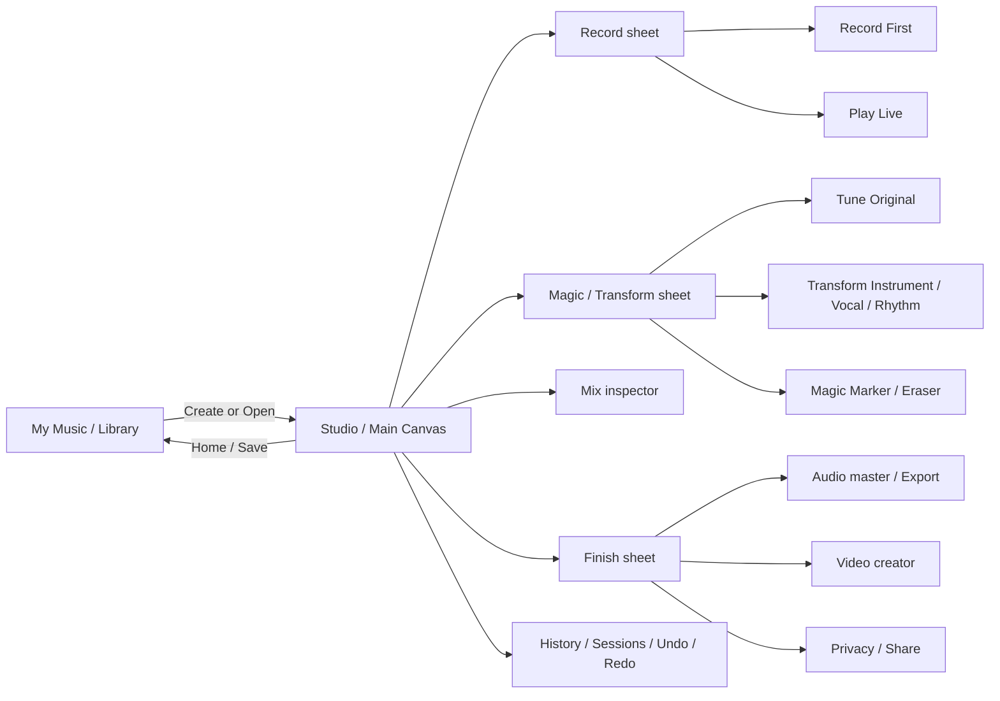

# UX and Responsive Wireframe Specification

## Visual reference
See `responsive-mobile-tablet-desktop.png`, `studio-flow-live-record.png`, `horizontal-studio-flow.png`. Images are illustrative and may show more than two visual states; only two **top-level destinations** exist.

## Navigation and layout
**My Music**: search, My Songs / Shared with Me / Community (future, age-gated), Create New, draft/final badges, privacy, duration, last edited, reopen, rename, duplicate, archive/delete with confirmation. No loss of sessions.
**Studio**: persistent project title/save status, play/pause, record, metronome, tempo, undo/redo, timeline playhead, stacked colored waveforms, add layer, context-aware transform/mix/finish actions. The horizontal **timeline pans left/right through time**, independently of vertical track scrolling. Avoid accidental gesture conflict: swipe timeline to pan, pinch to zoom; swipe sheets only by handle. Track labels remain sticky. Optionally snap to bars and show overview mini-map. No separate screens for Record/Transform/Mix/Finish.

## Responsive rules
- **Mobile (<768px):** one studio canvas; sticky transport/top bar and action dock; panels open as bottom sheets (large accessible controls), timeline pans horizontally, layer labels sticky; use collapsed inspector. My Music is separate destination.
- **Tablet (768–1199px):** library sidebar optional, larger multi-track timeline, right contextual inspector, bottom transport; drawers may remain pinned.
- **Desktop (>=1200px):** optional left My Music rail, center timeline/canvas, right inspector, keyboard shortcuts; still the same two destinations, not separate routes per tool.
- Use accessible contrast in dark mode, not glow as sole state indicator; respect reduced motion.

## Core interaction model
**Add Sound** opens `Record First | Play Live`, input category icons (hum/sing, clap/tap, beatbox, instrument/import), metronome on/off, BPM, count-in, headphones guidance, monitor options (original / transformed / both), record/pause/stop/retake, recording timer and live meter. One tap records; stopping opens preview then `Keep / Try Again`.
**Make Magic** on selected layer opens `Tune Original | Transform | Magic Fix` with clear tabs. `Tune`: Clean / Pitch / Timing / Enhance, Auto Fix, before/after, strength controls. `Transform`: instrument/vocal/rhythm/creative categories, large pictorial tiles, preserve melody/rhythm toggle, preview, keep as variant or new layer, apply. `Magic Fix`: Magic Marker selection or Magic Eraser brush with one-tap suggestions and explanation.
**Mix** opens track volume, pan L/R, mute, solo, gain, reverb/effects, optional advanced EQ, automation later; transport stays accessible. **Finish** opens master presets, audio quality and video packages, preview, export, privacy/sharing.

## Pan clarification
Two distinct concepts must be implemented: **horizontal canvas panning** (scrolling along the song timeline) and **audio stereo panning** (positioning each track left/right in the stereo field). Do not conflate them. Track inspector includes an L–C–R stereo pan control with centered default, accessible numeric and reset controls. The user's earlier request for 'left right panning' was visual canvas panning; stereo audio pan is also useful in the mix.

## Wireframe sitemap

## Microcopy
- Empty: 'Make your first sound.'
- Magic: 'I heard some clicks. Want me to try removing them?'
- Preview: 'Listen before you keep it.'
- Restore: 'Your original recording is safe.'
- Failure: 'I couldn't remove that sound cleanly. Try a smaller selection or record again.'
- Processing: 'Making a preview… You can keep working.'
- Save: 'Saved just now' / 'Saving…' / 'Couldn't save—retry'.

## Accessibility
Minimum 44x44 CSS px targets, aim 56–72px for primary touch actions; screen reader labels, color + text statuses, visible focus, keyboard shortcuts on desktop, scalable type, optional spoken guidance and captioned instructions. No forced public profile or child-generated uploads to community.
